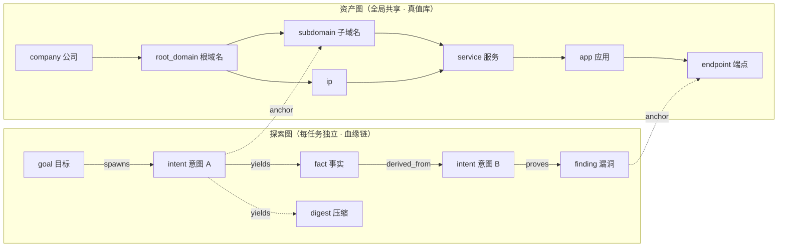
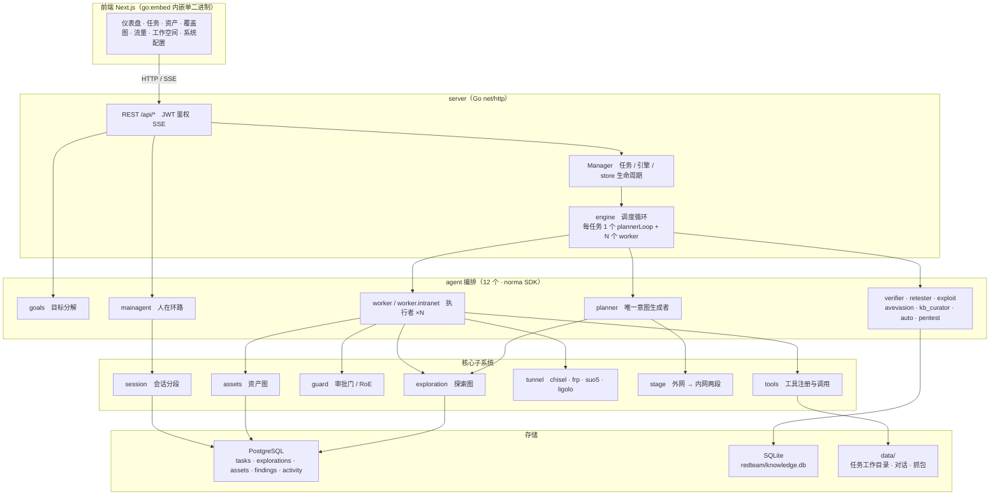
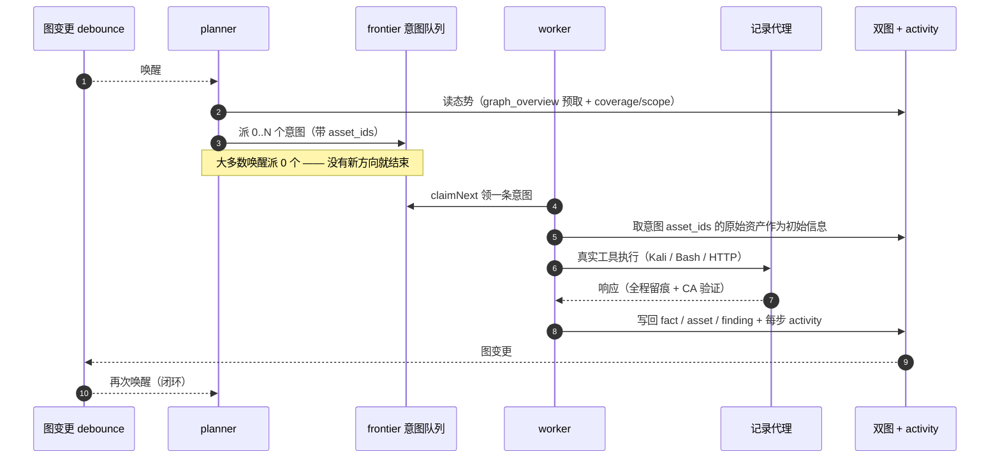
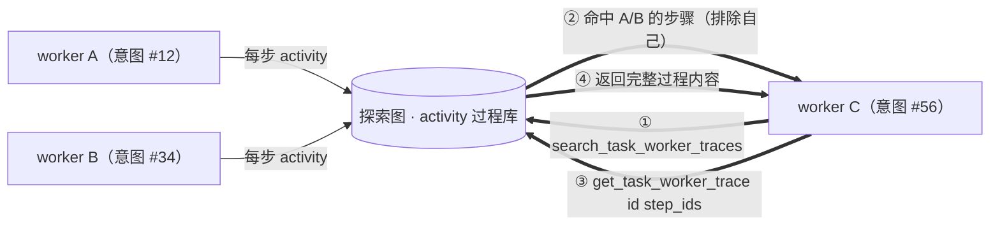
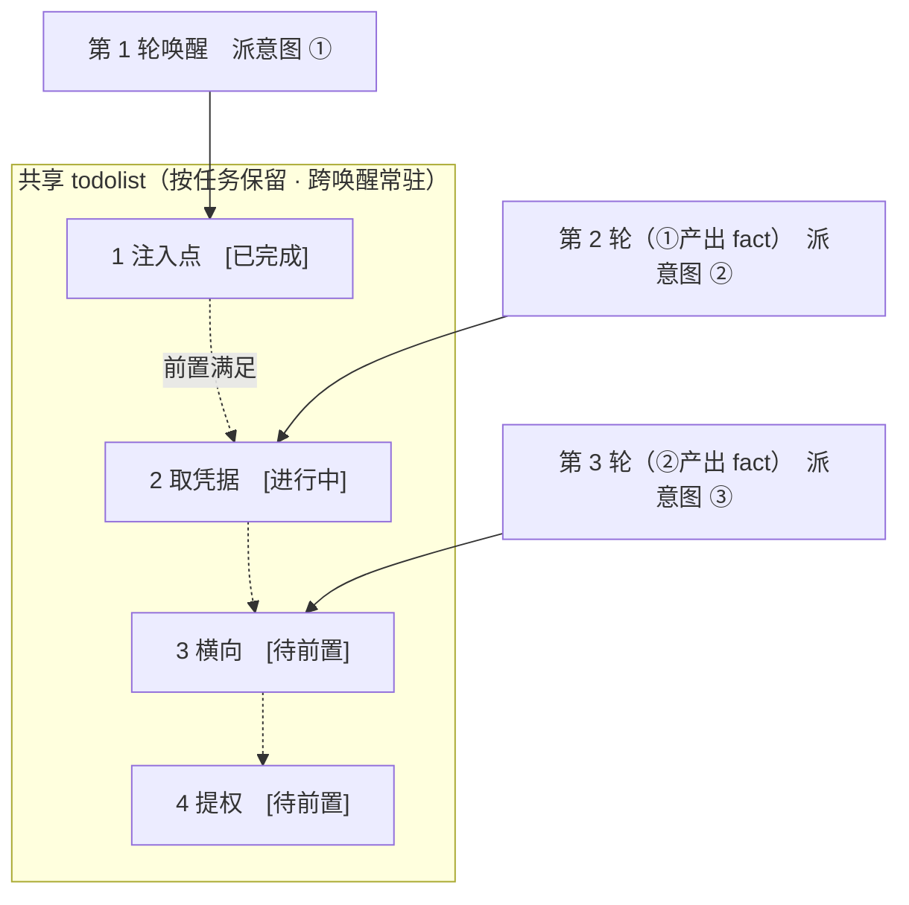

# DARKIN

**AI 自主渗透测试系统** —— 从外网突破到内网纵深的完整作战平台。

Go 单体后端 + 内嵌 Next.js 前端 + PostgreSQL，一条命令启动，浏览器里指挥。

```
版本    0.8.1
构建    Windows · Linux(amd64/arm64) · macOS(arm64)
形态    单二进制（前端静态资源内嵌）
```

文档：[开发指南](DEVELOPMENT.md) · [二开分支说明](README-FORK.md) · [源码包说明](README-源码包说明.md) · [在线激活服务器部署](deploy/actserver/README.md) · [部署说明](部署说明.txt)

---

## 一、它是什么

传统扫描器给你一堆漏洞列表，剩下的事（能不能打进去、打进去之后去哪）还是人做。
DARKIN 把这一段也接管了：

```
给定目标 → 自主侦察 → 规划攻击链路 → 执行验证 → 拿到立足点
        → 内网测绘 → 横向 → 提权 → 收口
```

中间每一步都由 Agent 自己决定下一步做什么，人只在**危险操作**上被询问（审批门）。

它不是"聊天框里贴个 payload"那种形态 —— 有一个持续的探索图在推进，你看到的是它在想什么、做了什么、下一步打算做什么。

---

## 二、运行要求

```
PostgreSQL   16 或 18（远程/本地/容器都行）
LLM          至少一个：DeepSeek / Anthropic / OpenAI，或任意 OpenAI 兼容端点
             在 UI 的「API KEY 配置」里填，也可以走环境变量
             内置快速预设：Drink Ai / NodeDog / DeepSeek / OpenRouter / Gemini 等
编译源码另需  Go 1.26.10+ · Node 20+（go.mod 里声明的就是 1.26.10）
```

---

## 三、快速开始

### 发布包（推荐）

```
Windows    DARKIN-*-win-x64.7z       7-Zip / WinRAR 解压，双击 start.bat
Linux/Mac  DARKIN-*-*.tar.gz         tar -xzf 解压，./start.sh
```

文件名以实际发布目录为准；旧便携打包脚本可能仍输出 `ARTEX-*` 前缀，解压后的二进制与界面均为 DARKIN。

Windows 包自带 PostgreSQL 便携版和全套工具，解压即跑，不需要装任何东西。
Linux/Mac 包用系统 PG，`install-deps.sh` 会装依赖并在首启时建好 Python 工具环境。

首次启动会自动建表，浏览器打开 `http://127.0.0.1:8787`，首次在页面设置本机管理员密码。

### 源码编译

在干净的 Linux 上从头构建，实际需要这几步（Ubuntu 26.04 上实测过一遍）：

```bash
# 1. 依赖：Go 1.26.10+ / Node 20+ / PostgreSQL
#    go.mod 里声明的是 go 1.26.10，低版本会触发 GOTOOLCHAIN 自动下载
sudo apt install -y postgresql postgresql-client nodejs npm
#    Go 建议直接用官方包（发行版的版本通常太旧）
curl -sSL https://go.dev/dl/go1.26.10.linux-amd64.tar.gz | sudo tar -C /usr/local -xz
export PATH=/usr/local/go/bin:$PATH

# 2. 数据库
sudo systemctl enable --now postgresql
sudo -u postgres psql -c "CREATE DATABASE artex;"
sudo -u postgres psql -c "ALTER USER postgres PASSWORD '你的密码';"

# 3. 配置
cp config.example.json config.json
#    改 database 那几项；knowledge_dir 指向 redteam

# 4. 前端静态导出
cd web && npm ci && NEXT_EXPORT=1 npx next build && cd ..

# 5. 拷进内嵌目录（-tags embedui 才会把前端打进二进制）
rm -rf server/webui/dist && cp -r web/out server/webui/dist

# 6. 编译
CGO_ENABLED=0 go build -tags embedui \
  -ldflags "-s -w -X main.version=0.8.1" -o darkin ./cmd/artex

./darkin
```

实测数据（Ubuntu 26.04 / 16 核 / 31 GB，Go 1.26.10 + Node 20.20.2）：

```
npm ci                39 秒，721 个包
next build            ~20 秒，42 个路由
go build（不带前端）   47 MB，约 40 秒（含依赖首次下载）
go build -tags embedui 45 MB，前端确认内嵌
```

**注意源码包和发布包不是一回事**：发布包里有 `install-deps.sh`（一键装 PG、装 Python
工具、写配置），源码仓库里没有。自己从源码构建的话，Python 工具（impacket 系、
sqlmap、pypykatz、netexec）要单独跑一次 `packaging/python-tools.sh`，或者按需求手动装。

`build.sh` 支持多平台交叉编译：

```bash
ARTEX_BUILD_VERSION=0.8.1 ./build.sh linux/amd64 windows/amd64 darwin/arm64
```

### 本地账号与授权

每台 DARKIN 部署使用**自己的本地管理员密码**（首次启动在页面设置，bcrypt 存 PostgreSQL），
账号之间完全隔离，不存在跨客户登录。

授权支持两种方式，最终都会落到同一张 **Ed25519 设备绑定 license**：

**A. 在线激活（发卡平台推荐）**

```json
{
  "activation_server": "https://artex.darkin.ai",
  "license_revoke_url": "https://artex.darkin.ai/v1/revocation"
}
```

- 发卡平台卖 voucher（`DARKIN-XXXXX-...`）；
- 客户端首次激活把 voucher + 设备 ID 发给激活服务器；
- 服务器绑定设备并返回 `DARKIN1...` license；
- 之后断网可用；可选查吊销；
- 激活管理端 `/admin/login`：数据库管理员账号 + 会话/CSRF + 角色权限，
  支持 voucher 编辑/暂停、设备重签续期、筛选导出和审计。

**B. 手工离线签发**

```bash
go run ./cmd/licgen -client '客户' -days 365 -machine '<设备ID>' -out license.dat
```

- 客户端激活页粘贴 `license.dat` 内容；
- 设备 ID 硬绑定，网卡只记录，到期日/功能位写进签名；
- `licensing/priv.key` 只留在签发机/激活服务器，绝不进客户端或发布包；
- 防破解构建：`./scripts/build-obfuscated.sh`（garble 字符串加密 + 去符号 + 完整性/反调试）。

---

## 四、能做什么

### 双图架构
两份图同时维护，互为约束：

**探索图（exploration）** —— 「怎么打」。节点是意图（intent），边是依赖关系。
一个意图表达"我想达成什么"，由 planner 拆解、worker 执行、verifier 验证。意图有生命周期：
`open → running → done / blocked / dead`，blocked 的意图在条件满足时会被重新唤醒。

**资产图（asset）** —— 「打了什么」。域名、IP、端口、服务、端点、应用，带来源任务和发现链路。
所有发现都要落到资产上，避免「同一个东西被反复挖」。

两张图的关系：探索图决定下一步探哪里，资产图决定哪些已经探过。这解决了两类典型问题 ——
重复挖同一个面、以及探到的资产没人接着用。




两图靠 `exploration_anchors(node_id, asset_id)` 相连：既可以从「探索方向」看它打了哪些资产，
也可以从「某个资产」反查它在本次任务被哪些意图测过、得出过什么事实 —— 资产测试覆盖度就是这么算的。

### Agent 编排
12 个内置 Agent，各管一段：

| Agent | 职责 |
| --- | --- |
| `mainagent` | 主控，接收指令、调度、向人汇报 |
| `planner` | 拆目标、排优先级、维护跨轮 todolist |
| `worker` | 执行单个意图（外网） |
| `worker.intranet` | 执行单个意图（内网） |
| `verifier` | 验证漏洞是否真实可利用 |
| `retester` | 复测已修复/已变化的目标 |
| `exploit` | 漏洞利用 |
| `avevasion` | 免杀与载荷适配 |
| `goals` | 目标分解 |
| `kb_curator` | 把有效手法沉淀进知识库 |
| `auto` | 通用执行体 |
| `pentest` | 渗透测试流程编排 |

每个 Agent 的提示词可以单独改、有版本历史，改完即时生效。

**模型可以分层指定**：任务级 → 单 Agent 级 → 全局默认。
比如 planner 用强模型、worker 用便宜的，或者这一个任务单独换模型，互不影响。
会话标题旁的模型徽章点开就能切，并标明当前用的是哪一层的配置。

### 会话与上下文

主 Agent 的对话是**分段**的：一个任务下的会话 #1、#2、#3 各自独立上下文，
打完一个阶段可以开新会话，旧会话保留可回看、可删除。任务进度、资产、意图不受影响。

worker 的每一次执行也是独立会话，可以随时点进去看它当时收到了什么、跑了什么、返回了什么。

会话上有三个操作：

```
新建    开一段干净上下文，旧段转为只读历史
删除    连同该段的对话记录一起删；任务最初那段（会话 #1）不可删
撤回    退回到最后一条用户消息之前，之后的回答和工具步骤一并删掉
```

**模型按会话所在的任务切换。** 会话标题旁的徽章点开就是模型列表，切换只影响
「本任务的这个 Agent」——不动任务配置链，也不影响其他任务。

徽章悬停会标明当前模型的来源：

```
本任务覆盖      这一层优先级最高
Agent 绑定      全局生效，所有任务共用
任务配置链      任务创建设定的那串
全局默认        什么都没配时才用它
```

所以在全局换了模型、而这里没变的时候，能直接看出是被哪一层压住了，不用猜。


### 知识库
POC 与方法论语料存在本地 SQLite（`knowledge.db`），与 PG 里的业务数据分离，可以整库搬走。

**多机共享**（0.4.6 起）：

```
知识源     配一台对端的地址 + 分享 token，点同步就增量拉取
分享 token 给别人的只读凭据，不是登录 JWT —— 泄露了只能拉知识库
冷备份     打包成 zip（VACUUM INTO，不是直接拷文件），能直接给别人
导入备份   按 code 增量合并，不覆盖本地已标注的条目
清空       清行 + VACUUM 回收空间，并重置同步游标
```

同步按 `poc.code` 去重，已存在的走更新（保留本地的 verified / 命中次数等标注），
所以两台机器各自积累的条目能合到一起，不会互相覆盖。

### 内网纵深
拿到立足点之后的部分：

```
立足点    WebShell 管理（哥斯拉/冰蝎）、C2 会话
隧道      chisel · frp · suo5 · ligolo，多层代理链路
凭据      抓取、复用、横向
测绘      内网段扫描、服务识别、域内枚举
提权      提权面清点、可用 exploit 匹配
```

隧道有端口池管理和链路巡检，断了会重建。

### 安全与审批
执行前有拦截层，命中规则的操作要人点头。三档可调：

```
off     不拦
warn    拦下来但允许放行，记审计
strict  必须批准
```

规则覆盖工具调用、payload 内容、目标范围。RoE（作战范围）可以预设哪些目标能打、哪些操作类型禁止 ——
越界直接拒绝，不靠 Agent 自觉。

---

## 五、界面

### 三个视图

任务页里有三个视图，分别回答三个问题。节点和连线都是按类型着色的，不用读文字也能分出是什么。

**探索链路 · 探索图** —— 「怎么想到的」

意图派生出什么事实，事实又引出什么意图。节点 8 类：

```
根任务  起点  目标  提示  意图  事实  漏洞  压缩
```

边 4 色表示派生关系：

```
生成 spawns        绿
推导 derived_from  橙
产出 yields        琥珀
证实 proves        红
```

**探索链路 · 攻击图** —— 「怎么打穿的」

按攻击阶段分列：入口 → 服务 → 漏洞 → 立足点 → 终点。节点 8 类各有颜色
（目标 / 信息 / 服务 / 危险点 / 漏洞 / 凭据 / 立足点 / 终点）。

连线里最该看的是两条：

```
橙色实线   当前最优 RCE 路径（系统算出来的，不是画的）
紫色虚线   内网横向（PIVOTS_TO），表示从一个段跳到另一个段
其余深灰   普通依赖关系
```

节点上百个时默认只显示攻击链路 + 邻居，否则整张图读不了。

**资产覆盖图** —— 「还有哪些面没探」

按层级展开：公司 → 根域名 → 子域名 / IP → 服务 → 应用 → 端点。
节点大小随层级递减，颜色区分类型。用来判断一个目标的面探到什么程度、
哪些资产还没被任何意图摸过。

三个视图的数据都来自同一份 exploration / asset 记录，不是另外算的摘要。

## 六、技术架构

### 分层



```
cmd/artex           启动、参数、版本注入
  server/           HTTP + SSE，全部 API 端点
  engine/           意图调度、并发控制、生命周期
  agent/            Agent 定义与工具注入
  planning/         planner 逻辑、todolist
  exploration/      探索图
  assets/           资产图
  guard/            拦截与审批
  session/          会话管理
  tunnel/           隧道子系统
  stage/            阶段编排
  tools/            工具注册与调用
  kb/               知识库（SQLite）
  db/               PostgreSQL 访问层
  licensing/        离线激活码签验、签名密钥与设备标识
  web/              Next.js 前端（构建产物内嵌）
```

单体二进制的好处：没有服务间通信、没有版本错配，一个 exe 拷过去就能跑。

### 一次探索的闭环

```
1. 任务创建        描述 + 目标 → 建 exploration，写初始资产
2. 目标分解        goals agent 拆成若干 intent
3. planner 排序    按资产价值和风险排优先级，维护跨轮 todolist
4. worker 领取      并发受控，每个 worker 拿一个 intent
5. 执行            调工具 / 抓流量 / 验证，过程落 activity（可回放）
6. verifier 验证    确认漏洞真实可利用，过滤误报
7. 资产落库        新发现的域名/IP/服务写进资产图
8. 回到 3          未完成的继续，blocked 的等条件满足后唤醒
```

全过程通过 SSE 实时推到前端，界面上的每条记录都是真实执行过的步骤，不是生成的摘要。



### worker 之间的过程级交换

worker 之间不共享上下文 —— 每个 worker 是一次独立执行，拿到的只有「意图 + 资产」。
但它们执行时的每一步都落在 `activity` 里，可以互相查。



作用是避免重复踩坑：C 想试一个注入点，可以先查 A 是不是已经试过、当时返回了什么，
而不是自己再打一遍。

### planner 的共享 todolist

planner 每轮唤醒都会重读态势，但它需要的不是「上次想到哪」，而是「这条链路走到第几步了」。
所以按任务维护一份 todolist，跨唤醒常驻：



有了这份 todolist，planner 不必每次从零推理攻击链，上下文也不会随轮次膨胀。

### 数据存在哪

```
PostgreSQL      tasks / explorations / exploration_nodes / assets / findings
                activity / settings / agents / llm_profiles …
SQLite          redteam/knowledge.db（POC 与方法论）
文件            data/tasks/<id>/（任务工作目录：下载物、命令输出、截图）
                data/transcripts/（对话记录）
                license.dat（可选：离线激活文件，也可直接粘到激活页）
                data/traffic/（抓包）
```

---

## 七、配置

`config.json`（与二进制同目录）：

```json
{
  "database": {
    "host": "127.0.0.1",
    "port": 5432,
    "user": "postgres",
    "password": "你的密码",
    "dbname": "artex",
    "sslmode": "disable"
  },
  "knowledge_dir": "redteam",
  "allow_lan": false,
  "activation_server": "https://artex.darkin.ai",
  "license_revoke_url": "https://artex.darkin.ai/v1/revocation"
}
```

| 字段 | 说明 |
| --- | --- |
| `allow_lan` | `false` 只监听 127.0.0.1；`true` 监听 0.0.0.0。要给别人访问就开 |
| `knowledge_dir` | 知识库目录，相对路径以二进制所在目录为基准 |
| `callback_addr` | 目标回连平台用的地址（反弹 shell / 隧道需要），也可用环境变量 `ARTEX_CALLBACK_ADDR` |
| `activation_server` | 可选：在线激活服务器；留空 = 只接受离线 license |
| `activation_server_ca` | 可选：内网私有 CA 的 PEM 路径 |
| `license_revoke_url` | 可选：在线吊销检查端点；留空 = 纯离线 |

### 反向代理（HTTPS）

面板默认是明文 HTTP。要挂域名 + 证书，Nginx：

```nginx
server {
    listen 443 ssl http2;
    server_name darkin.example.com;

    ssl_certificate     /etc/ssl/darkin/fullchain.pem;
    ssl_certificate_key /etc/ssl/darkin/privkey.pem;

    location / {
        proxy_pass http://127.0.0.1:8787;
        proxy_http_version 1.1;
        proxy_set_header Host              $host;
        proxy_set_header X-Real-IP         $remote_addr;
        proxy_set_header X-Forwarded-For   $proxy_add_x_forwarded_for;
        proxy_set_header X-Forwarded-Proto $scheme;

        # 任务流是 SSE，必须关掉缓冲，否则界面不实时
        proxy_buffering off;
        proxy_read_timeout 3600s;
    }
}
```

Caddy 只要两行：

```
darkin.example.com {
    reverse_proxy 127.0.0.1:8787
}
```

---

## 八、工具链

随包提供 34 件（Windows）/ 25 件（Linux/Mac）二进制：

```
侦察      subfinder  dnsx  naabu  httpx  katana  gospider  ksubdomain
Web       nuclei（14,035 模板）  ffuf  dirsearch  oneforall
内网      fscan  gogo
隧道      chisel  frp(frpc+frps)  suo5  ligolo  penelope
提权      linpeas  peass
其他      mihomo（代理池）  mcp  wordlists
Python    impacket 家族（secretsdump/psexec/wmiexec/atexec/GetUserSPNs…）
          sqlmap  pypykatz  netexec
```

Linux/Mac 上 Python 工具由 `install-deps.sh` 在首启时建 venv 装好，不随包带二进制。
mac-arm64 缺 `fscan`（fscan 官方未提供 darwin 编译产物）。

技能库 65 项，放在 `skills/`，按需注入 Agent 上下文，不占常驻 token。

---

## 九、许可

本项目采用 **GNU AGPL-3.0**（见 [`LICENSE`](LICENSE)）。通过网络向他人提供服务时，
须按 AGPL 第 13 条向使用者提供完整对应源码。

软件仅供**获得授权的安全测试与研究**使用。未经授权不得用于攻击任何目标。
每台部署使用本地管理员账号；授权由离线签名激活码控制，支持机器绑定、到期和可选吊销检查。

使用本工具进行任何测试，必须事先获得目标所有者的书面授权。
使用者对自己的一切操作及其后果负责。
